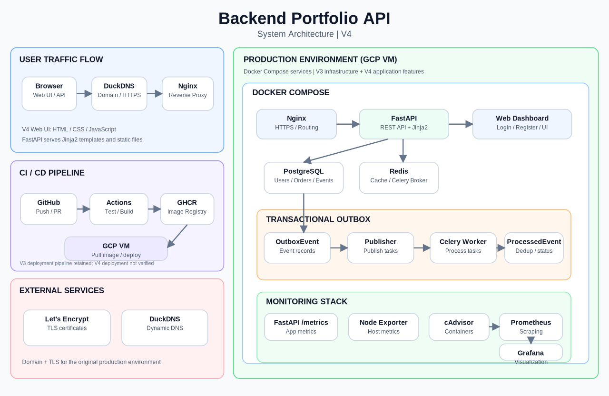

# Backend Portfolio V4

以 **FastAPI** 打造的全端作品集，整合 REST API、PostgreSQL、Redis、Celery、JWT 權限管理、監控與 CI/CD，並提供可實際操作的 Web Dashboard。系統已部署至 **Google Cloud Compute Engine**，使用 Docker Compose、Nginx 與 HTTPS 運行。

## Live Demo

**正式網站：** https://backend-portfolio-api.duckdns.org/

[Dashboard](https://backend-portfolio-api.duckdns.org/) · [登入](https://backend-portfolio-api.duckdns.org/demo/login) · [註冊](https://backend-portfolio-api.duckdns.org/demo/register) · [Swagger API](https://backend-portfolio-api.duckdns.org/docs)

### Demo Accounts

| 角色 | Email | 密碼 |
|---|---|---|
| User | `user1@test.com` | `123456` |
| Admin | `toby@test.com` | `123456` |

> Demo 帳號使用正式環境的展示資料；Admin 具有使用者管理權限。

## Features

| 功能 | 說明 |
|---|---|
| Dashboard | 系統狀態、使用者資訊與功能入口 |
| Register / Login | 使用者註冊、JWT 登入與帳號停權驗證 |
| Products | 商品清單、分頁、庫存顯示 |
| Orders | 建立及刪除訂單、自動扣除與回補庫存 |
| Order Events | 查詢 Outbox 事件發送與背景處理狀態 |
| Admin | 使用者清單、角色及啟用狀態管理 |
| API Security | JWT、RBAC、訂單所有權驗證、Redis 登入限流 |
| Reliability | PostgreSQL Row-Level Lock、Transactional Outbox、Celery |
| Observability | Request ID、Prometheus、Grafana、Node Exporter、cAdvisor |

## System Architecture



**主要資料流程：**

1. 瀏覽器透過 HTTPS / Nginx 存取 FastAPI 與 Jinja2 Web UI。
2. FastAPI 透過 PostgreSQL 儲存使用者、商品與訂單；Redis 提供快取、登入限流及 Celery Broker。
3. 訂單與 `OutboxEvent` 在同一個資料庫交易中寫入，Publisher 將事件送往 Celery Worker。
4. Worker 完成背景處理後記錄 `ProcessedEvent`，前端可查詢事件狀態。
5. Prometheus 收集監控指標，Grafana 提供視覺化監控。

## Tech Stack

| 分類 | 技術 |
|---|---|
| Backend | Python 3.12、FastAPI、SQLAlchemy、Pydantic、Alembic |
| Frontend | Jinja2、HTML、CSS、JavaScript、Fetch API |
| Database | PostgreSQL 17 |
| Cache / Broker | Redis 7 |
| Async Jobs | Celery、Transactional Outbox |
| Authentication | OAuth2、JWT、Argon2、RBAC |
| Testing | Pytest、HTTPX、AnyIO |
| Deployment | Docker Compose、Nginx、Let's Encrypt、GCP Compute Engine |
| CI/CD | GitHub Actions、GitHub Container Registry（GHCR） |
| Monitoring | Prometheus、Grafana、Node Exporter、cAdvisor |

## API & Web Routes

| 路徑 | 功能 |
|---|---|
| `/` | Dashboard |
| `/demo/login` | 登入頁 |
| `/demo/register` | 註冊頁 |
| `/demo/products` | 商品頁 |
| `/demo/orders` | 訂單頁 |
| `/demo/events` | 訂單事件頁 |
| `/demo/admin` | 管理員頁 |
| `/users`、`/users/login` | 註冊與登入 API |
| `/products`、`/orders` | 商品與訂單 API |
| `/orders/{id}/events` | 訂單事件查詢 |
| `/admin/users` | 管理員使用者 API |
| `/docs` | Swagger UI |
| `/health` | 健康檢查 |
| `/metrics` | Prometheus 指標 |

## CI/CD Deployment

```text
Push / Pull Request
        ↓
GitHub Actions CI（Pytest + Docker Build）
        ↓
Merge to main → CI Success
        ↓
GitHub Actions CD
        ↓
Build Image → Push to GHCR
        ↓
SSH to GCP VM → Docker Compose Deploy
        ↓
Health Check / Deployment Validation
        ├── Success → Complete
        └── Failure → Rollback
```

正式環境以 Git Commit SHA 標記 Docker Image，確保部署版本可追蹤。

## Verification

**自動化測試：`46 passed`（Pytest）**

V4 已完成正式環境部署及實際操作驗收：

| 驗證項目 | 結果 |
|---|---|
| GitHub Actions CI/CD | PASS |
| HTTPS、Login、Dashboard | PASS |
| PostgreSQL 商品與使用者資料 | PASS |
| User / Admin RBAC（403 / Admin Access） | PASS |
| 訂單建立、庫存扣除 | PASS |
| 訂單刪除、庫存回補 | PASS |
| Outbox → Publisher → Celery Worker | PASS |
| Event `Completed` | PASS |
| Admin 停權、阻擋登入、恢復帳號 | PASS |
| Docker Compose 10 個服務運行 | PASS |

## Run Locally

```bash
# 建立本機環境設定（依專案 env 範例填入必要變數）
docker compose --env-file .env.dev -f compose.yaml -f compose.dev.yaml up -d --build

# 執行測試
python -m pytest -q
```

本機網頁入口：`http://localhost/`；API 文件：`http://localhost/docs`。
